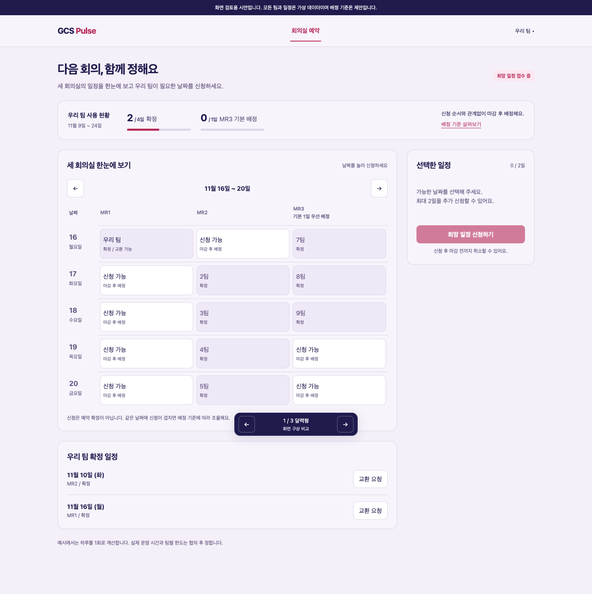
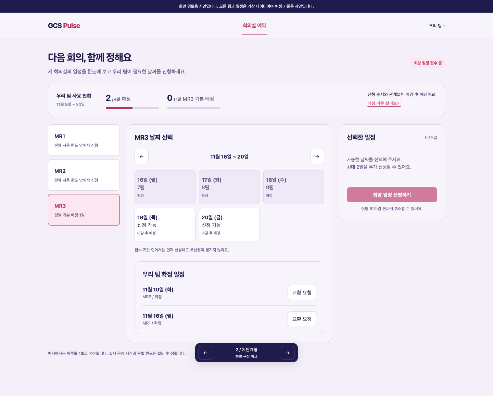
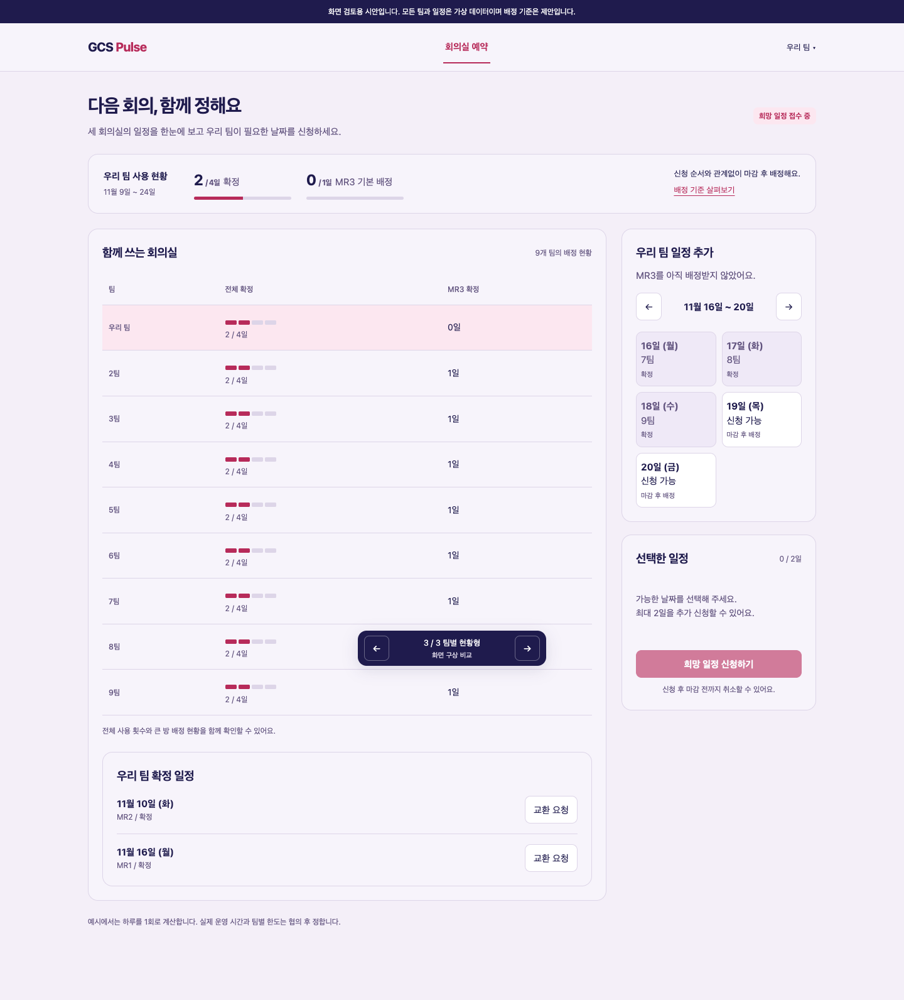
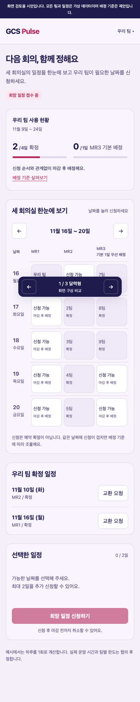
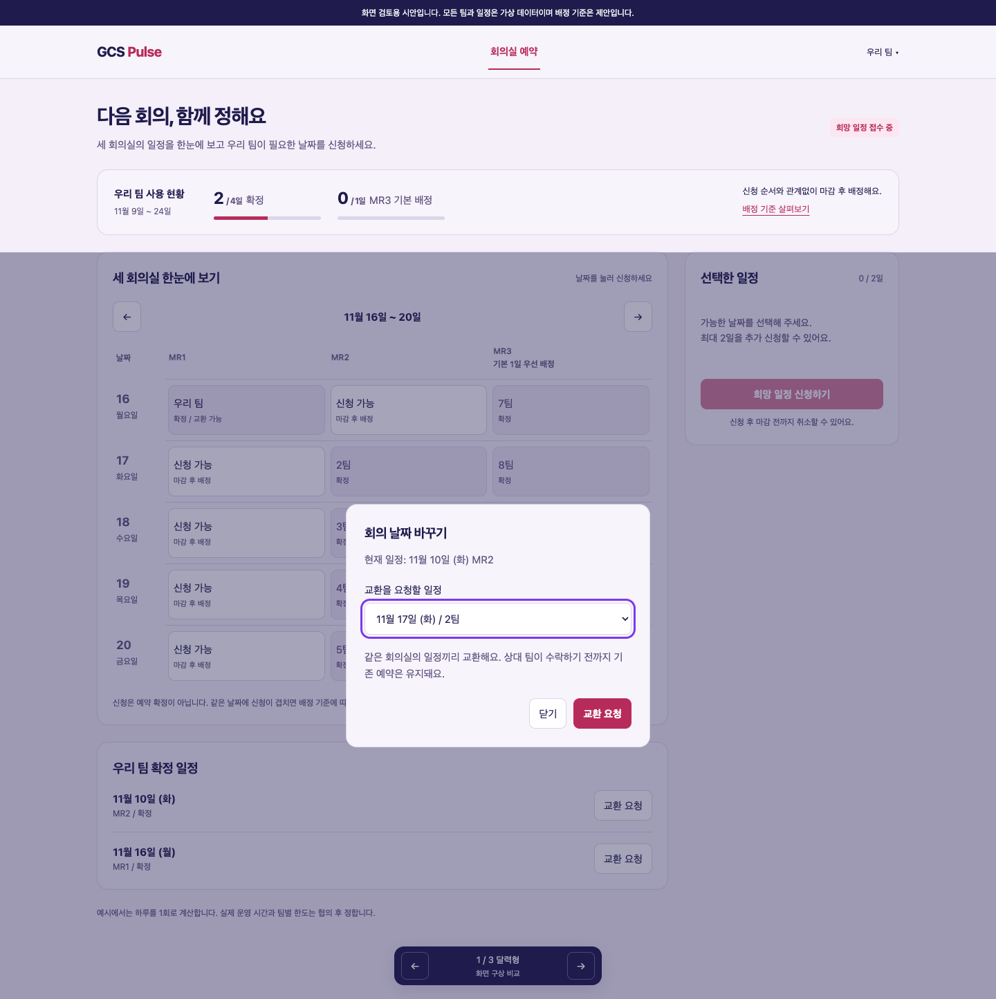

# 팀별 회의실 배정 화면 제안

팀별 사용 횟수를 확인하면서 세 회의실의 희망 일정을 신청하고, 확정된 날짜를 다른 팀과 교환할 수 있는 화면을 제안합니다. 기존 회의실 예약 기능에 어떻게 연결하면 좋을지 검토하기 위한 시안입니다.

**이번 변경은 문서와 독립된 화면 시안입니다. 운영 예약, API, 데이터베이스, 배정 정책은 변경하지 않습니다.** 회의실 이름은 MR1, MR2, MR3로 표시합니다. 팀, 날짜, 배정 내역은 가상 데이터입니다. 팀당 4일과 큰 방 기본 1일은 화면 검토를 위한 예시이며 확정된 운영 규칙을 의미하지 않습니다.

큰 방 배정 대상은 MR3입니다. 2026년 10월 26일 회의실 목록 조회에서 North와 South 모두 MR3가 MR1, MR2보다 큰 수용 인원으로 안내되는 것을 확인했습니다. 시안에는 구역 접두사를 생략해 MR1, MR2, MR3로 표시하며, 실제 서비스 연결 시 구역과 방 ID를 함께 구분해야 합니다.

## 바로 확인하기

추가 패키지나 로그인 없이 이 디렉터리의 `index.html`을 브라우저에서 열면 됩니다. 저장소 루트에서는 다음 명령으로 열 수 있습니다.

```sh
python3 -m http.server 8765 --directory doc/prototypes/meeting-room-allocation
```

접속 주소: <http://localhost:8765/?variant=calendar>

아래 세 구성을 같은 화면에서 비교할 수 있습니다. 하단의 화살표나 키보드 좌우 화살표로 전환하며, 선택한 구성은 주소에 남습니다. 일정 신청 상태는 메모리에서만 유지되며 새로고침하면 초기화됩니다.

| 구성 | 주소의 옵션 | 확인하려는 점 |
| --- | --- | --- |
| 달력형 | `?variant=calendar` | 날짜별로 방 3개의 예약과 빈자리를 함께 보면 선택하기 쉬운가 |
| 단계형 | `?variant=guided` | 회의실을 먼저 고른 뒤 날짜를 선택하는 흐름이 익숙한가 |
| 팀별 현황형 | `?variant=teams` | 팀별 전체 사용량과 큰 방 배정 현황을 함께 보여주는 것이 도움이 되는가 |

우선 검토안은 달력형입니다. 같은 날짜의 다른 방을 바로 비교할 수 있고, 현재 예약 화면의 날짜 및 회의실 선택을 한곳으로 모을 수 있습니다. 단계형은 기존 선택 순서에 가깝고, 팀별 현황형은 운영 상황을 함께 확인하는 보조 화면으로 검토할 수 있습니다.

## 화면 미리보기

### 달력형



### 단계형



### 팀별 현황형



<details>
<summary>모바일 화면과 교환 요청 화면</summary>

모바일 화면은 세 회의실을 같은 날짜 행에서 비교하고, 신청 목록을 아래로 배치합니다.



교환 요청 시 현재 예약과 교환할 상대 일정을 함께 보여줍니다.



</details>

## 시안에서 직접 확인할 수 있는 흐름

1. 기본 화면에서 11월 19일 MR3를 선택합니다.
2. 11월 20일 MR3를 추가 선택하면 기본 배정 1일 안내가 나옵니다.
3. 다른 날짜의 작은 회의실을 선택해 총 2일을 추가 신청합니다.
4. 신청한 일정은 확정과 구분되어 배정 대기로 표시됩니다. 신청을 취소하면 다른 날짜를 고를 수 있습니다.
5. 우리 팀 확정 일정의 교환 요청을 누르면 같은 회의실을 가진 다른 팀의 날짜를 고를 수 있습니다.
6. 교환 요청 후 기존 확정 일정은 유지되고 응답 대기로 표시됩니다.

같은 날짜에는 한 회의실만 선택할 수 있습니다. 예시 한도는 확정 일정, 접수한 신청, 현재 선택을 합산합니다. 시안은 신청 접수와 교환 요청까지 표현하며, 추첨, 실제 배정, 상대 팀의 수락과 거절, 알림 전송은 구현하지 않았습니다.

## 검토할 배정 방식

예시로 9개 팀이 12개 평일에 회의실 3개를 하루 단위로 사용하면 전체 공급은 36일입니다. 모든 팀의 4일 사용을 계획할 수 있지만, 특정 날짜에 신청이 집중되면 날짜 조율이 필요합니다. 단순히 횟수를 나눈 것만으로 원하는 일정이 보장되지는 않습니다.

| 항목 | 검토안 | 함께 정할 점 |
| --- | --- | --- |
| 전체 사용 | 팀별 4일 | 하루 사용권인지 시간 구간인지, 실제 참여 팀 수 |
| 큰 방 기본 배정 | 모든 팀에 1일씩 우선 배정 | 신청 충돌 시 대체 날짜 수집과 조율 방식 |
| 큰 방 추가 배정 | 남은 3일을 추가 추첨 | 팀별 최대 2일 여부, 참여 조건과 추첨 공개 방법 |
| 전체 횟수 유지 | 큰 방 추가 배정도 총 4일 안에서 처리 | 이미 확정된 작은 방을 바꿀 때 동의와 처리 순서 |
| 신청 순서 | 접수 기간 안에서는 동일하게 취급 | 접수 마감 시각과 결과 안내 시각 |
| 일정 교환 | 같은 회의실의 날짜끼리 교환 | 수락 기한, 요청 철회와 거절 처리 |
| 잔여 자리 | 배정 후 빈자리 신청 | 최초 배정과 별도로 적용할 한도와 우선순위 |

화면에는 큰 방의 기본 배정 신청만 표현했습니다. 추가 배정은 위 기준에 대한 합의 이후 별도 흐름으로 연결해야 합니다. 이 시안에서 사용자가 신청할 수 있는 날짜 수는 대체 날짜의 수가 아니라 실제로 요청하는 사용일 수입니다. 대체 날짜를 제출하는 기능은 후속 구현에서 분리해야 합니다.

## 실제 서비스에 연결할 때

현재 회의실 화면은 `apps/client/src/app/meeting-rooms/page.client.tsx`에 있고, 방 선택, 예약 조회, 시작 및 종료 시간 입력을 제공합니다. 예약 생성 API는 `apps/server/app/routers/meeting_rooms.py`에 연결됩니다. 이번 시안은 이 화면과 `doc/design-system.md`의 GCS 테마를 참고했습니다.

화면 방향과 운영 단위가 정해지면 기존 인증 및 팀 정보를 사용해 연결할 수 있습니다. 다음 사항은 서버 구현에서 확인해야 합니다.

- 사용량은 개인 계정 대신 해당 기간의 팀을 기준으로 계산합니다.
- 팀별 한도와 방 중복 검사는 서버에서 수행해 웹과 CLI에 동일하게 적용합니다.
- 희망 일정 신청과 확정 예약을 별도 상태로 관리하고, 접수 마감 이후 배정 결과를 확정합니다.
- 같은 조건의 경쟁 신청을 처리하는 규칙과 결과 근거를 남깁니다.
- 교환 수락 시 두 예약과 관련 날짜 충돌을 다시 확인하고 한 트랜잭션에서 변경합니다. 거절 또는 만료 시 기존 예약을 유지합니다.

배정 엔진, 데이터 모델 변경, 실제 예약 전환은 이번 문서 PR 범위에 포함하지 않습니다.

## 확인한 범위

- 세 구성의 표시와 주소 옵션 전환, 새로고침 후 구성 유지
- 날짜 선택, 같은 날짜의 중복 선택 제한, 큰 방 기본 한도, 전체 한도
- 신청 접수와 신청 취소, 교환 요청 후 기존 예약 유지
- 데스크톱 화면과 모바일 390px 및 320px의 가로 넘침 여부
- 위 동작 중 브라우저 실행 오류 없음

배정 알고리즘의 공정성, 동시 요청, 실제 계정과 예약 데이터 연동, 모든 운영 테마, 보조기기 접근성은 검증하지 않았습니다. 화면 코드에는 외부 요청과 저장 기능이 없습니다.

## 다음 검토

현재는 화면과 운영 방식을 함께 검토하는 개방형 설계 단계입니다. 먼저 하루와 시간 구간 중 사용 단위를 정하고 달력형 화면의 적합성을 확인하면 좋겠습니다. 이 검토는 현재 제안 범위에 포함되며, 운영 정책과 데이터 변경은 별도 합의 후 진행합니다.
